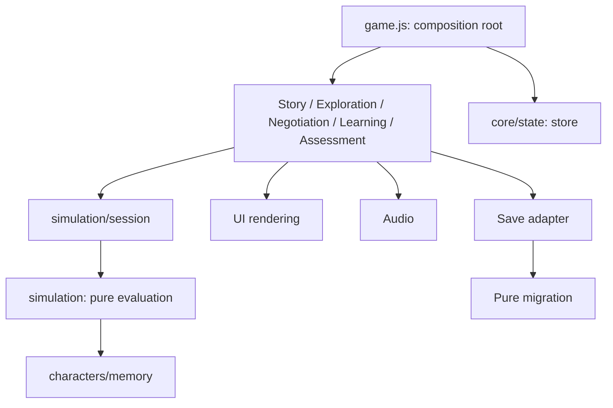

# Kiến trúc Modular Vanilla JavaScript v8.0

## Điểm xuất phát và phạm vi

Đợt refactor tiếp nối commit `11067bf`, không reset/revert source hay lịch sử. Trước khi tách module, chạy lại toàn bộ bộ QA v8: **230/230 assertion PASS**, build PASS. Bằng chứng trước refactor ở `artifacts/modular-baseline/`; kết quả hiện tại ở `artifacts/qa/`. Gameplay, nội dung học thuật và schema save vẫn là v8. Không xóa `scripts/game.js`: file này trở thành composition root.

## Lựa chọn module và offline

ES Modules hỗ trợ import/export chuẩn và scope riêng, nhưng module loader của trình duyệt thường chặn import từ `file://` do chính sách origin/CORS. Chuyển source sang ESM sẽ buộc người chơi dùng HTTP hoặc chỉ dùng bản build. Yêu cầu giữ cách mở trực tiếp source khiến factory module chạy bằng classic script là lựa chọn phù hợp ở đây.

`scripts/core/modules.js` cung cấp đúng ba thao tác `VCX.define(name, dependencies, factory)`, `VCX.get(name)` và `VCX.graph()`. Registry đồng bộ, không tải mạng, không `eval`, không bundler/framework runtime. Nó phát hiện tên trùng, module thiếu và dependency vòng; chỉ khởi tạo factory một lần. Namespace `VCX` là điểm truy cập duy nhất trên browser; các biến `state`, `scene`, `renderHall`, `VCXSim` và các binding gameplay cũ không còn nằm ở global scope.

`index.html` khai báo script có `defer`, registry đầu tiên, bootstrap cuối cùng. Factory chỉ xuất API; module thuần có CommonJS adapter để Node chạy cùng mã trong test. Các constructor nhận dependencies có tên, không tự tìm các thành phần khác qua registry. Chỉ composition root thực hiện wiring; không có event bus hay service locator trong feature.

`tools/build_offline.py` nhúng các script theo đúng thứ tự từ HTML cùng CSS và 58 asset vào file riêng trong `dist/`. Source chính vẫn tách file. QA mở cả source `file://` và bản standalone được copy sang thư mục tạm chỉ chứa một file, tắt mạng, chạy gameplay thật. Không dùng ZIP lồng trong build.

## Ranh giới trách nhiệm

| Module / file | Trách nhiệm và API chính |
|---|---|
| `core/modules.js` | Registry và kiểm tra dependency; không giữ tiến trình game |
| `core/state.js` | `initialState`, `freshLearning`, `createStore`; state của một phiên và session điều hướng |
| `game-data.js` | Catalog cảnh, chứng cứ, điều khoản, công cụ, nhân vật, lời mời; dùng chung Node/browser |
| `simulation.js` | Đánh giá thuần `evaluate`, `effective`, `concerns`, minimum/veto/feasibility/trust/community/ending; không DOM/storage/network |
| `simulation/session.js` | Bind evaluate/history vào store hiện tại; không giữ bản sao state, không render |
| `characters/memory.js` | Interest profile, memory và history, record, dialogue, mood; nhận evaluator làm tham số để không import ngược simulation |
| `story/dialogue.js` | Truyện full/demo, tiến câu thoại, portrait theo kịch bản và typewriter có reduced motion |
| `exploration/evidence.js` | Bản đồ/WASD/touch, điều tra 3 nơi, 9 chứng cứ, 3 mini-game, ghép chứng cứ và 2 nhiệm vụ phụ |
| `negotiation/index.js` | Mời họp, sửa điều khoản, chọn chứng cứ/công cụ, nghe phản biện và quy trình ứng phó độ mặn |
| `learning-content.js` | 9 concept mapping, nội dung khái niệm, 10 câu quiz, 3 kịch bản/rubric tranh biện |
| `learning.js` | Knowledge Panel, concept map, gợi ý theo tình huống và tranh biện có cấu trúc |
| `assessment/model.js` | Learning profile, ưu tiên lợi ích và điểm quiz thuần từ hành vi/state; không DOM |
| `assessment/index.js` | Debrief, dashboard, UI quiz và giải thích đáp án |
| `assessment/report.js` | Tổng hợp learning/decision report và tải TXT |
| `ui/rendering.js` | DOM helpers, asset presentation, chuyển màn/focus, atmosphere, shared dialog và modal accessibility |
| `ui/ending.js` | Trình bày kết thúc đã được engine quyết định và phản hồi học tập |
| `ui/journal.js` | Nhật ký tiến độ, chứng cứ, gợi ý nhiệm vụ |
| `audio.js` | Nhạc ngày/căng thẳng, SFX, gesture gating, âm lượng, visibility; playback state riêng |
| `storage/migration.js` | Migration/validation thuần; không đọc/ghi localStorage |
| `storage/save-load.js` | Adapter đọc/ghi, key cũ, quota/error handling, resume checkpoint và khóa save tương lai; hỗ trợ backend giả trong test |
| `game.js` | Tạo store/services/features, nối callback, đăng ký controls chung và lifecycle start/resume/reset; không chứa nội dung truyện hay luật kinh tế |

`simulation.js` giữ các export tương thích `freshMemory`, `freshLearning`, `record`, `mood`, `dialogue`, `migrate` cho API v8 đã có; phần triển khai thuộc module phụ trách. Migration là hàm thuần nên export tương thích này không đưa localStorage vào engine.

## Dependency và luồng điều khiển



Mỗi feature nhận một object chứa đúng các dịch vụ cần dùng. Những chuyển tiếp giữa feature được composition root nối bằng callback cụ thể, ví dụ story → bản đồ, negotiation → màn ending, ending → debrief, assessment → export TXT. Feature không import bootstrap hoặc import ngược feature gọi nó. `VCX.graph()` cung cấp đồ thị dependency khai báo; test duyệt đồ thị và thử trường hợp dependency vòng thật.

Store chứa state có thể thay đổi; đây không phải immutable/reducer framework. Mỗi feature luôn đọc `store.state`, không destructure/capture state ở thời điểm khởi tạo. Bởi vậy `begin`, `reset`, `resume` có thể thay state mà callback cũ vẫn đọc đúng phiên mới. Biến tạm như bước biến cố, chọn chứng cứ, walking keys, debate draft và audio flags nằm trong closure của module sở hữu. Store session chỉ giữ scene, storyPos, activePlace và trạng thái chờ resume; không nhúng DOM hoặc Audio vào save.

## Simulation và state được giữ tương thích

Giữ `saveVersion:8`, `found`, `done`, `minis`, `board`, `invited`, `policies`, `governance`, `govProof`, `mode`, `mapPos`, `npcTalk`, `sideQuests`, `crisis`, `result`, `decisionSerial`, `crisisSequence`, `memory`, `learning`, `decisions`.

`evaluate(state,catalog)` trả actors gồm interest profile, score, trust riêng, concerns, critical IDs, minimum, accepted; trả community, checks và result. Các chỉ số dẫn xuất không ghi ngược save. Kết thúc A cần đồng thời đủ tham gia, minimum riêng, đồng thuận, niềm tin, khả thi, môi trường và ứng phó biến cố; không thay đổi luật qua refactor.

Memory mỗi NPC giữ concern đã gặp, tối đa 60 sự kiện quan hệ gần nhất và thoại gần nhất. History tối đa 500 quyết định, giữ chứng cứ, được/mất, phản ứng, hệ quả và snapshot. Debate/quiz không cộng lợi ích kinh tế hay buộc NPC đồng thuận. Chỉ báo học tập không tự tính phần chuẩn bị sẵn khi trình chiếu.

## Save/load

Đọc lần lượt `vcx_v80`, `vcx_v71`, `vcx_v7`, `vcx_v6`, `vcx_v4`; migration lọc ID/kiểu/giới hạn và tiến độ bất khả thi. Ghi chỉ `vcx_v80`, không xóa key cũ. Không đổi schema hay key do refactor. Save từ phiên bản tương lai khóa ghi; lỗi quyền/quota được báo và không làm ngừng game. Mở kiến thức ở home không ghi đè checkpoint đang chờ Resume.

Legacy ending giữ nhãn kết quả cũ và đối chiếu điều kiện v8; người chơi có thể trở lại sửa thỏa thuận để đánh giá lại. Origin/file path/trình duyệt khác có thể dùng vùng lưu khác, như trước refactor.

## Kiểm thử và cách sửa tiếp

```sh
node tools/test_modules.cjs
node tools/test_simulation.cjs
python tools/build_offline.py
uv run --with-requirements tools/requirements-qa.txt python tools/run_qa.py
python tools/write_release_reports.py
```

- `test_modules.cjs`: registry/graph, import không cần DOM, store độc lập/thay state, storage lỗi/future/legacy, model assessment thuần; đối chiếu chính xác 48 contract evaluate/dialogue/migrate chụp từ engine trước refactor.
- `test_modular_browser.py`: source và standalone offline không nạp adapter QA, xác minh không rò binding global, tiếp tục save v8 cũ, đạt A qua UI, sửa thỏa thuận, reset/begin, thu chứng cứ và keyboard/mobile.
- Bộ simulation exhaustive 1.417.176 phương án cuối; browser v8 chạy A/B/C, điều tra/mini-game/debate/quiz/save/export/demo; QA cũ và axe tiếp tục chạy.
- `browser_test_bridge.js` chỉ được Playwright inject cho các test cũ cần truy cập state/handler. Nó không nằm trong `index.html` hoặc standalone. Bộ production browser riêng xác minh game hoạt động khi không có bridge.
- Asset/syntax/DOM scans và source SHA manifest dùng `rglob`, bao gồm cả module trong thư mục con.

Thêm feature bằng factory với API hẹp, inject store và dịch vụ cần thiết tại `game.js`. Thêm script vào HTML trước bootstrap; packager tự nhúng theo danh sách đó. Tránh đọc DOM khi import module thuần, capture `store.state` dài hạn hoặc thêm biến gameplay lên `window`.
